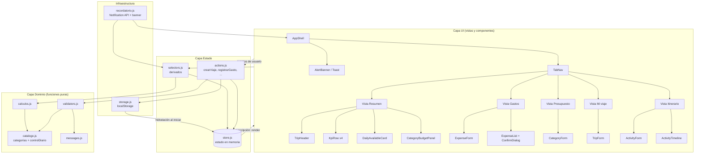
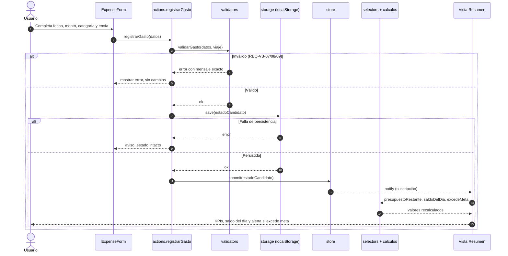
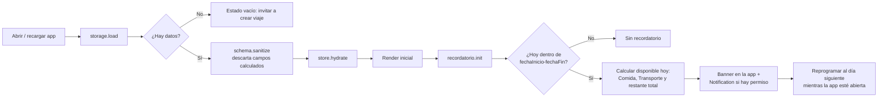

# Design Document
## Aplicación Web: Asistente de Viaje Personal (Itinerarios y Control de Presupuesto)

**Versión:** 1.0
**Fecha:** 2026-10-21
**Estado:** Borrador
**Autor:** Arquitecto de Software Senior
**Entradas:** `requirements.md` v1.1 (EARS), contrato de datos JSON (Lab S1L1), wireframe de la pantalla *Resumen*, contexto del proyecto (memoria semántica).

---

## 1. Alcance y principios de diseño

| # | Principio | Consecuencia en el diseño |
|---|---|---|
| P1 | **Sin backend.** Toda la lógica corre en el navegador (REQ-PER-*). | SPA estática, persistencia en `localStorage`. |
| P2 | **Cálculos derivados nunca se persisten** (REQ-UB-02, REQ-PER-03). | Capa `domain/calculos.js` con funciones puras; el esquema persistido no contiene campos calculados. |
| P3 | **Itinerario 100 % manual** (REQ-UB-01). | No existe ningún módulo de recomendación ni generación; solo CRUD de `Actividad`. |
| P4 | **Reglas de negocio fuera de la UI.** | Validación y cálculo en módulos de dominio testeables sin DOM. |
| P5 | **Una sola fuente de verdad.** | Un `store` central; la UI se renderiza como función del estado. |
| P6 | **Parametrizable por viaje.** | El usuario puede tener varios viajes; cada uno con su presupuesto y categorías (requisito 3 del cliente). |

**Stack propuesto:** HTML5 + CSS3 + JavaScript (ES Modules), sin framework ni *build step*, para mantener el laboratorio simple. La arquitectura es compatible con migrar a un framework de componentes (React/Vue/Svelte) sin cambiar las capas de dominio, estado y persistencia.

**Fuera de alcance:** generación/recomendación de itinerarios, backend, cuentas de usuario, multi-moneda (el atributo `moneda` fue retirado del contrato).

---

## 2. Arquitectura de componentes de la interfaz (según wireframe)

### 2.1 Interpretación del wireframe

El wireframe define la pantalla **Resumen** (vista por defecto) y una barra de navegación con cinco secciones: **Resumen · Mi viaje · Gastos · Presupuesto · Itinerario**. El recuadro "X" superior izquierdo se interpreta como control de cierre/menú del contenedor `AppShell`. Solo *Resumen* está dibujado; el contenido de las otras cuatro pestañas se **deriva** del contrato de datos y de los requisitos (ver §2.3).

```
┌───────────────────────────────────────────────────────────────┐
│ [X]  Asistente viaje                                          │  AppShell
│ [Resumen][Mi viaje][Gastos][Presupuesto][Itinerario]          │  TabNav
│        ┌──────────────────────────────────────────┐           │
│        │ Nombre del viaje  y  disponible           │           │  TripHeader
│        └──────────────────────────────────────────┘           │
│ ┌────────────┐ ┌─────────┐ ┌────────────┐ ┌─────────────┐     │
│ │Presup.Total│ │ Gastado │ │ Disponible │ │Días del viaje│     │  KpiRow (4 KpiCard)
│ └────────────┘ └─────────┘ └────────────┘ └─────────────┘     │
│     ┌──────────────────────────────────────────┐              │
│     │ Disponible hoy: Transporte / Comida       │              │  DailyAvailableCard
│     └──────────────────────────────────────────┘              │
│   ┌────────────────────────────────────────────┐              │
│   │ Presupuesto por categoría                   │              │  CategoryBudgetPanel
│   └────────────────────────────────────────────┘              │
└───────────────────────────────────────────────────────────────┘
```

### 2.2 Árbol de componentes — vista *Resumen* (wireframe)

| Componente | Elemento del wireframe | Responsabilidad | Datos (selectores) |
|---|---|---|---|
| `AppShell` | Marco + "X" + título "Asistente viaje" | Layout, cierre/menú, contenedor de toasts y banner de recordatorio. | `selectViajeActivo` |
| `TabNav` | Resumen, Mi viaje, Gastos, Presupuesto, Itinerario | Navegación por pestañas (estado de UI, no persistido). | `ui.tabActiva` |
| `TripHeader` | "Nombre del viaje y disponible" | Muestra `nombre` y `presupuestoRestante`. | `selectPresupuestoRestante` |
| `KpiRow` / `KpiCard` ×4 | Presupuesto Total · Gastado · Disponible · Días del viaje | Totales globales. | `presupuestoGlobal`, `selectGastoTotal`, `selectPresupuestoRestante`, `selectTotalDias` |
| `DailyAvailableCard` | "Disponible: Transporte, Comida" | Disponible **del día** de Comida y Transporte (`saldoDelDia`), con color positivo/negativo y alerta si `excedeMeta`. | `selectResumenDiario(fecha, 'Comida' \| 'Transporte')` |
| `CategoryBudgetPanel` | "Presupuesto por categoría" | Una `CategoryRow` por categoría: asignado, gastado, restante, barra de progreso; `limiteDiario` si aplica. Destaca Comida y Actividades. | `selectResumenCategorias` |
| `AlertBanner` / `Toast` | (implícito, req. cliente 4) | Alertas de exceso de meta, errores de validación, confirmaciones. | `ui.alertas` |

### 2.3 Componentes de las demás pestañas (derivados)

| Pestaña | Componentes | Contenido |
|---|---|---|
| **Mi viaje** | `TripSelector`, `TripForm`, `DeleteTripButton` | Alta/edición de viaje (nombre, fechas, presupuesto global); selección entre viajes; eliminación en cascada con aviso de irreversibilidad. |
| **Presupuesto** | `CategoryForm`, `CategoryList` | Alta/edición de categorías (nombre restringido al catálogo de 5), `montoAsignado`; indicador de monto sin asignar (informativo). |
| **Gastos** | `ExpenseForm`, `ExpenseList`, `ConfirmDialog` | Registro (fecha, monto, descripción opcional, categoría); listado agrupado por fecha con **resaltado** de Comida y Actividades (req. cliente 2); eliminación con confirmación. |
| **Itinerario** | `ActivityForm`, `ActivityTimeline` | Alta/edición/eliminación manual de actividades, agrupadas por fecha y ordenadas por hora. **Sin sugerencias automáticas.** |

### 2.4 Diagrama de componentes



---

## 3. Estructura de módulos

```
/
├─ index.html
├─ css/
│  └─ styles.css
├─ docs/
│  ├─ requirements.md
│  └─ design.md
├─ js/
│  ├─ main.js                      # bootstrap: hidratar, suscribir, render, recordatorio
│  ├─ constants/
│  │  └─ messages.js               # mensajes de error EXACTOS de requirements.md
│  ├─ domain/                      # puro, sin DOM ni storage
│  │  ├─ catalogo.js               # 5 categorías válidas + controlDiario fijo
│  │  ├─ validators.js             # validarViaje / Categoria / Gasto / Actividad / CambioFechas
│  │  ├─ calculos.js               # totalDias, restante, limiteDiario, saldoDelDia, excedeMeta...
│  │  ├─ money.js                  # parseo, conteo de decimales, aritmética en centavos
│  │  └─ dates.js                  # AAAA-MM-DD, rangos, diferencia de días (sin +1)
│  ├─ state/
│  │  ├─ store.js                  # estado + subscribe/notify
│  │  ├─ actions.js                # casos de uso: validar → mutar → persistir → notificar
│  │  └─ selectors.js              # derivaciones para la UI
│  ├─ persistence/
│  │  ├─ storage.js                # load/save/clear sobre localStorage
│  │  └─ schema.js                 # versión de esquema + sanitización (descarta campos calculados)
│  ├─ notifications/
│  │  └─ recordatorio.js           # recordatorio matutino
│  └─ ui/
│     ├─ components/               # TripHeader, KpiCard, DailyAvailableCard, CategoryRow, ...
│     └─ views/                    # ResumenView, MiViajeView, GastosView, PresupuestoView, ItinerarioView
└─ tests/                          # pruebas unitarias de domain/ y state/
```

**Regla de dependencias:** `ui → state → domain`; `state → persistence`; `domain` no depende de nadie. Esto permite probar todas las reglas EARS sin navegador.

### 3.1 Catálogo de categorías (`catalogo.js`)

```js
export const CATEGORIAS = Object.freeze({
  Hospedaje:   { controlDiario: false },
  Tiquetes:    { controlDiario: false },
  Transporte:  { controlDiario: true  },
  Actividades: { controlDiario: false },
  Comida:      { controlDiario: true  },
});
```

`controlDiario` **no se almacena ni se expone para edición**: se deriva del catálogo congelado. Así queda "fijo, sin permitir que el usuario lo modifique" por construcción (REQ-UB-03/04).

### 3.2 Fórmulas centrales (`calculos.js`)

Todas son funciones puras `f(viaje, ...) → valor`. Internamente los montos se manejan en **centavos enteros** para evitar errores de coma flotante.

| Campo | Fórmula | Notas |
|---|---|---|
| `totalDias` | `fechaFin − fechaInicio` | Sin `+1`, según decisión de contrato. Ver riesgo R1. |
| `gastado(cat)` | Σ `monto` de gastos de la categoría | |
| `restante(cat)` | `montoAsignado − gastado` | |
| `presupuestoRestante` | `presupuestoGlobal − Σ todos los gastos` | |
| `limiteDiario(cat)` | `montoAsignado / totalDias` | Solo si `controlDiario` y `totalDias > 0`. |
| `gastadoDelDia(cat, fecha)` | Σ gastos de esa categoría en esa fecha | |
| `saldoDelDia(cat, fecha)` | `limiteDiario − gastadoDelDia` | Negativo ⇒ exceso. |
| `excedeMeta(cat, fecha)` | `gastadoDelDia > limiteDiario` | |
| `disponibleDia` (Comida) | `(montoAsignado_Comida / totalDias) − gastadoDelDia_Comida(fecha)` | Igual a `saldoDelDia` de Comida; aplica a fecha pasada, actual o futura dentro del rango (REQ-PD-04). |

---

## 4. Manejo de estado: global vs. LocalStorage

### 4.1 Decisión

| Tipo de dato | Dónde vive | ¿Persistido? | Ejemplos |
|---|---|---|---|
| **Datos de dominio (fuente de verdad)** | Estado global en memoria (`store`) **y** espejo en `localStorage` | **Sí** | Viajes, categorías, gastos, actividades, `viajeActivoId` |
| **Datos derivados/calculados** | Selectores (se recalculan en cada render) | **No** (REQ-UB-02, REQ-PER-03) | `presupuestoRestante`, `totalDias`, `gastado`, `restante`, `limiteDiario`, `gastadoDelDia`, `saldoDelDia`, `excedeMeta` |
| **Datos fijos de negocio** | Constantes (`catalogo.js`) | No (son código) | `controlDiario` por categoría |
| **Estado efímero de UI** | Objeto `ui` del store | **No** | Pestaña activa, fecha consultada en Resumen, diálogos abiertos, toasts, errores de formulario |

**Razón:** el volumen de datos es pequeño (KB) y el acceso síncrono de `localStorage` simplifica la regla "persistir *antes* de confirmar" (REQ-PER-01). `IndexedDB` queda como evolución si se añadieran adjuntos (recibos, fotos).

### 4.2 Esquema persistido

Clave: `asistenteViaje.v1`

```json
{
  "schemaVersion": 1,
  "viajeActivoId": "v_01",
  "viajes": [
    {
      "id": "v_01",
      "nombre": "Costa Rica - Guanacaste",
      "fechaInicio": "2026-12-01",
      "fechaFin": "2026-12-08",
      "presupuestoGlobal": 1500.00,
      "categorias": [
        { "nombre": "Comida", "montoAsignado": 400.00 },
        { "nombre": "Transporte", "montoAsignado": 150.00 }
      ],
      "gastos": [
        { "id": "g_01", "fecha": "2026-12-02", "monto": 12.50, "descripcion": "Almuerzo", "categoria": "Comida" }
      ],
      "actividades": [
        { "id": "a_01", "fecha": "2026-12-01", "hora": "09:00", "descripcion": "Llegada y check-in" }
      ]
    }
  ]
}
```

- Los **ids** son un detalle técnico de implementación (necesarios para editar/eliminar); no forman parte del contrato funcional.
- `schema.js` **descarta explícitamente** cualquier campo calculado presente al cargar o guardar (defensa en profundidad para REQ-PER-03 / REQ-UB-02).
- `schemaVersion` permite migraciones futuras sin perder datos del usuario.

### 4.3 Ciclo de una operación de escritura (patrón único en `actions.js`)

1. La UI invoca una acción con los datos crudos del formulario.
2. `validators.js` aplica las reglas de borde; si falla, devuelve el **mensaje exacto** del requirements y **no hay mutación**.
3. Se construye el **nuevo estado candidato** (inmutable).
4. `storage.save(candidato)`. Si falla (cuota, modo privado) → se descarta el candidato, se muestra error y el estado en memoria queda intacto.
5. Solo si persistió, `store.commit(candidato)` y se notifica a los suscriptores → la UI se re-renderiza y todos los totales se recalculan "en tiempo real" sin recargar la página (REQ-PG-02, REQ-VB-14).
6. Se evalúan alertas (`excedeMeta`) y se emite toast de confirmación.

### 4.3.1 Flujo de datos — registrar un gasto



### 4.3.2 Flujo de datos — arranque y recordatorio



---

## 5. Diseño de módulos clave

### 5.1 `validators.js`
Funciones puras que retornan `{ ok: true }` o `{ ok: false, campo, mensaje }`. Los mensajes provienen de `messages.js` y son **textuales** a los del requirements.md. Validan en el orden: obligatoriedad → formato → rango → regla cruzada.

### 5.2 `recordatorio.js`
- Al iniciar y mientras la app permanezca abierta, evalúa si la fecha actual está dentro del rango del viaje activo.
- Contenido del mensaje: disponible de **Comida** hoy, disponible de **Transporte** hoy y **presupuestoRestante** total (cubre el requisito 1 del cliente, que es un superconjunto de REQ-RD-01).
- Canales: banner dentro de la app (siempre) y `Notification API` (si el usuario concede permiso).
- **Limitación técnica documentada:** sin backend ni *push*, un sitio web no puede garantizar una notificación con la pestaña cerrada. El requisito (REQ-RD-01) ya lo condiciona a "aplicación activa o notificaciones habilitadas". Evolución posible: Service Worker + Push (requiere servidor).

### 5.3 `selectors.js`
Capa de lectura única para la UI: `selectViajeActivo`, `selectTotalDias`, `selectGastoTotal`, `selectPresupuestoRestante`, `selectResumenCategorias`, `selectResumenDiario(fecha, categoria)`, `selectActividadesPorFecha`. Ningún componente hace aritmética por su cuenta.

### 5.4 Resaltado de alertas y de Comida/Actividades
- `excedeMeta = sí` ⇒ clase CSS `is-exceeded` (color de alerta + ícono + texto "Excediste la meta del día", para no depender solo del color) en `DailyAvailableCard` y `CategoryRow`.
- Comida y Actividades se renderizan con estilo de énfasis (etiqueta/ícono) en `ExpenseList` y `CategoryBudgetPanel` (requisito 2 del cliente).
- `saldoDelDia ≥ 0` ⇒ estilo positivo; `< 0` ⇒ estilo negativo (REQ-PD-03).

---

## 6. Mapeo explícito de requisitos → diseño

### 6.1 Presupuesto global y diario (§1 de requirements)

| REQ | Cómo se satisface | Módulos / componentes |
|---|---|---|
| **REQ-PG-01** | `validarViaje` acepta `presupuestoGlobal ≥ 0` y se persiste como atributo del `Viaje`; es la base de `presupuestoRestante`. | `validators.js`, `actions.crearViaje`, `TripForm`, `storage.js` |
| **REQ-PG-02** | Tras cada alta/baja de gasto, `commit` notifica al store y `selectPresupuestoRestante` recalcula `presupuestoGlobal − Σ gastos`; la UI se re-renderiza sin recarga. | `actions.registrarGasto/eliminarGasto`, `store.js`, `selectors.js`, `calculos.js`, `TripHeader`, `KpiCard` |
| **REQ-PG-03** | La vista Resumen muestra `presupuestoRestante` (TripHeader + KPI "Disponible") junto al desglose por categoría. | `ResumenView`, `CategoryBudgetPanel`, `selectResumenCategorias` |
| **REQ-PD-01** | `limiteDiario = montoAsignado / totalDias` solo si `CATEGORIAS[nombre].controlDiario && totalDias > 0`; se muestra en el `ResumenDiario`. | `calculos.limiteDiario`, `catalogo.js`, `DailyAvailableCard`, `CategoryRow` |
| **REQ-PD-02** | `excedeMeta = gastadoDelDia > limiteDiario` se evalúa tras cada gasto y en cada render; activa `is-exceeded` y un toast de alerta. | `calculos.excedeMeta`, `AlertBanner/Toast`, `DailyAvailableCard` |
| **REQ-PD-03** | `saldoDelDia = limiteDiario − gastadoDelDia` para Comida y Transporte, con estilo positivo/negativo. | `calculos.saldoDelDia`, `DailyAvailableCard`, CSS |
| **REQ-PD-04** | `disponibleDia` de Comida usa la fórmula exacta; el selector acepta cualquier `fecha` del rango (pasada, actual o futura) mediante el selector de fecha de la vista Resumen (por defecto, hoy). | `selectResumenDiario`, `ui.fechaConsulta`, `dates.js` |
| **REQ-RD-01** | `recordatorio.init` detecta si hoy está en el rango del viaje activo y emite banner/`Notification` matutina con disponible de Comida, Transporte y restante total. | `recordatorio.js`, `AppShell` |

### 6.2 Validaciones de borde (§2)

| REQ | Cómo se satisface | Módulos |
|---|---|---|
| **REQ-VB-01** | `validarViaje`: `nombre.trim() === ''` ⇒ rechaza con *"El nombre del viaje no puede estar vacío."* | `validators.js`, `messages.js`, `TripForm` |
| **REQ-VB-02** | `validarViaje`: `fechaFin < fechaInicio` ⇒ rechaza con el mensaje exacto. | `validators.js`, `dates.js` |
| **REQ-VB-03** | `validarViaje`: `presupuestoGlobal` negativo o no numérico ⇒ rechaza con el mensaje exacto. | `validators.js`, `money.js` |
| **REQ-VB-13** | `validarCambioFechas` compara cada `actividad.fecha` contra el nuevo rango; si alguna queda fuera, rechaza con *"Debe verificar y eliminar las actividades fuera del rango de fecha del viaje."* y **no persiste**. | `validators.js`, `actions.editarViaje` |
| **REQ-VB-04** | `validarCategoria` verifica duplicados por nombre dentro del viaje ⇒ mensaje exacto. | `validators.js`, `CategoryForm` |
| **REQ-VB-05** | `validarCategoria`: `nombre` vacío ⇒ mensaje exacto. | `validators.js` |
| **REQ-VB-06** | `validarCategoria`: `montoAsignado` negativo o no numérico ⇒ mensaje exacto. | `validators.js`, `money.js` |
| **REQ-VB-07** | `validarGasto`: `monto ≤ 0` o más de 2 decimales (verificado sobre la cadena ingresada, no sobre el `Number`) ⇒ mensaje exacto. | `validators.js`, `money.js` |
| **REQ-VB-08** | `validarGasto`: `fecha` vacía o que no cumple `AAAA-MM-DD` (incluye fechas inexistentes como 2026-02-30) ⇒ mensaje exacto. | `validators.js`, `dates.js` |
| **REQ-VB-09** | `validarGasto`: la `categoria` debe existir en `viaje.categorias`; además el selector del formulario solo ofrece categorías existentes. | `validators.js`, `ExpenseForm` |
| **REQ-VB-14** | `ConfirmDialog` previo a eliminar; al confirmar, `actions.eliminarGasto` persiste y hace `commit`; selectores recalculan `gastado` de la categoría y el saldo en la UI sin recarga. | `ExpenseList`, `ConfirmDialog`, `actions.js`, `selectors.js` |
| **REQ-VB-10** | `validarActividad`: `descripcion` vacía ⇒ mensaje exacto. | `validators.js`, `ActivityForm` |
| **REQ-VB-11** | `validarActividad`: `hora` (si se informa) debe cumplir `^([01]\d\|2[0-3]):[0-5]\d$` ⇒ mensaje exacto. | `validators.js` |
| **REQ-VB-12** | `validarActividad`: `fecha` dentro de `[fechaInicio, fechaFin]` ⇒ mensaje exacto. | `validators.js`, `dates.js` |

### 6.3 Persistencia local (§3)

| REQ | Cómo se satisface | Módulos |
|---|---|---|
| **REQ-PER-01** | Patrón de escritura §4.3: validar → `storage.save` → `commit` → confirmar. Si la persistencia falla, no se confirma ni se muta el estado. | `actions.js`, `storage.js` |
| **REQ-PER-02** | `main.js` ejecuta `storage.load → schema.sanitize → store.hydrate` antes del primer render; restaura viajes, categorías, gastos, actividades y viaje activo. | `main.js`, `storage.js`, `store.js` |
| **REQ-PER-03** | El esquema persistido (§4.2) no contiene campos calculados; `schema.sanitize` los elimina si aparecieran. Se recalculan en `calculos.js`. | `schema.js`, `calculos.js`, `selectors.js` |
| **REQ-PER-04** | `actions.eliminarViaje` muestra aviso de irreversibilidad; al confirmar elimina el viaje del arreglo (categorías, gastos y actividades están anidados en él ⇒ cascada garantizada por estructura) y persiste. | `TripSelector`, `DeleteTripButton`, `ConfirmDialog`, `actions.js` |

### 6.4 Restricciones de diseño — comportamiento inmutable (§4)

| REQ | Cómo se satisface | Módulos |
|---|---|---|
| **REQ-UB-01** | No existe código de recomendación/generación. El módulo Itinerario solo expone CRUD manual. Cualquier "generar/recomendar" no tiene ruta ni UI. Se agrega una prueba que verifica que `actions.js` no exporta acciones de generación. | `ItinerarioView`, `ActivityForm`, `tests/` |
| **REQ-UB-02** | Campos calculados solo existen en `calculos.js`/`selectors.js`; `schema.js` los excluye del almacenamiento. | `calculos.js`, `schema.js` |
| **REQ-UB-03** | `controlDiario = sí` para Comida y Transporte, leído del catálogo congelado; no hay control de UI ni campo almacenado que lo cambie. | `catalogo.js` |
| **REQ-UB-04** | `controlDiario = no` para Hospedaje, Tiquetes y Actividades, por el mismo mecanismo. | `catalogo.js` |
| **REQ-UB-05** | El campo nombre de `CategoryForm` es un `<select>` con los 5 valores; además `validarCategoria` rechaza cualquier otro nombre y muestra la lista de válidos. | `validators.js`, `catalogo.js`, `CategoryForm` |

### 6.5 Trazabilidad con los requisitos del cliente (entrevista)

| # | Requisito del cliente | Cobertura en el diseño |
|---|---|---|
| 1 | Alarma matutina: cuánto gastar en comida, transporte y cuánto queda en total | `recordatorio.js` (REQ-RD-01) + `DailyAvailableCard` |
| 2 | Destacar gastos de comidas y actividades | §5.4 (énfasis visual en `ExpenseList` y `CategoryBudgetPanel`) |
| 3 | Parametrizar gastos para distintos viajes | Múltiples viajes (`TripSelector`), presupuesto y categorías por viaje |
| 4 | Alertas al exceder el monto | `excedeMeta` (REQ-PD-02) + `AlertBanner/Toast` |

---

## 7. Estrategia de pruebas

| Nivel | Qué se prueba | Cómo |
|---|---|---|
| Unitarias (dominio) | Cada REQ-VB-* con casos válidos/inválidos y mensaje exacto; fórmulas de `calculos.js` (REQ-PD-*); bordes de fechas y decimales. | Runner ligero (Vitest/Jest o `node --test`) sobre `domain/` |
| Unitarias (estado) | Patrón validar→persistir→commit; rollback si `save` falla; cascada de REQ-PER-04; REQ-VB-13 y REQ-VB-14. | `state/` con `storage` simulado |
| Contrato | El JSON persistido nunca contiene campos calculados (REQ-PER-03/UB-02). | Prueba sobre `schema.sanitize` |
| Integración/manual | Recarga restaura estado (REQ-PER-02); alerta visual (REQ-PD-02); recordatorio (REQ-RD-01). | Checklist manual + prueba E2E opcional |

---

## 8. Riesgos, decisiones abiertas y brechas detectadas

| ID | Tema | Detalle | Recomendación |
|---|---|---|---|
| **R1** | `totalDias` sin `+1` | El contrato define `totalDias = fechaFin − fechaInicio`. Un viaje de 1 día (`fechaInicio = fechaFin`, permitido por REQ-VB-02) da `totalDias = 0`, lo que desactiva `limiteDiario` (REQ-PD-01 exige `totalDias > 0`). Además, un viaje del 1 al 8 tendría 7 "días" aunque dura 8 jornadas, y un gasto del día 8 quedaría fuera del divisor. | Confirmar con el cliente. Si se acepta, mostrar aviso "Sin meta diaria" en viajes de 0 días. Si no, cambiar a `+1` y actualizar el contrato. |
| **R2** | Fecha de gasto fuera del rango del viaje | REQ-VB-08 solo valida formato; ningún REQ exige que la fecha del gasto esté en el rango. | Proponer REQ-VB-15 (advertencia o rechazo). Mientras tanto, la fecha se acepta y no afecta ningún `ResumenDiario` fuera del rango. |
| **R3** | Suma de categorías vs. `presupuestoGlobal` | El contrato indica que el global "se reparte" entre categorías, pero no hay REQ que valide que la suma de `montoAsignado` ≤ `presupuestoGlobal`. | Mostrar indicador informativo "sin asignar / sobreasignado" (no bloqueante) hasta tener un REQ. |
| **R4** | REQ-VB-14: condición | La confirmación se condiciona a que la categoría tenga "al menos un registro"; como el gasto a eliminar ya es ese registro, la condición siempre se cumple. | Implementar confirmación **siempre**. Sugerir simplificar el EARS. |
| **R5** | Recordatorio con la app cerrada | Sin backend no hay *push* confiable. | Documentado en §5.2; evolución futura con Service Worker + servidor push. |
| **R6** | `localStorage` y cuotas/modo privado | Puede lanzar excepciones o vaciarse. | Manejo de errores en `storage.save`; ofrecer exportar/importar JSON como mejora futura. |
| **R7** | Aritmética decimal | Sumas con `Number` generan errores (0.1 + 0.2). | Cálculo interno en centavos enteros (`money.js`). |
| **R8** | Cambio de `montoAsignado` o fechas con gastos ya registrados | No está especificado qué pasa con `limiteDiario` histórico. | Como no se persiste, se recalcula siempre con los valores vigentes; documentar este comportamiento. |

---

## 9. Plan de implementación sugerido

1. `domain/` (catálogo, money, dates, validators, calculos) + pruebas unitarias.
2. `persistence/` + `state/` (store, actions, selectors) con pruebas del patrón de escritura.
3. Vistas **Mi viaje** y **Presupuesto** (permiten crear datos).
4. Vista **Gastos** (registro, eliminación con confirmación).
5. Vista **Resumen** (wireframe completo) con alertas.
6. Vista **Itinerario**.
7. Recordatorio matutino y pulido de accesibilidad (alertas no solo por color).
8. Revisión de trazabilidad contra la matriz §6.

---

## 10. Matriz de trazabilidad (resumen)

| Sección del requirements | REQ | Sección de este diseño |
|---|---|---|
| §1.1 Presupuesto global | PG-01..03 | §3.2, §4.3, §6.1 |
| §1.2 Presupuesto diario | PD-01..04 | §3.1, §3.2, §5.4, §6.1 |
| §1.3 Recordatorio | RD-01 | §4.3.2, §5.2, §6.1 |
| §2 Validaciones de borde | VB-01..14 | §5.1, §6.2 |
| §3 Persistencia | PER-01..04 | §4, §6.3 |
| §4 Restricciones | UB-01..05 | §3.1, §6.4 |
